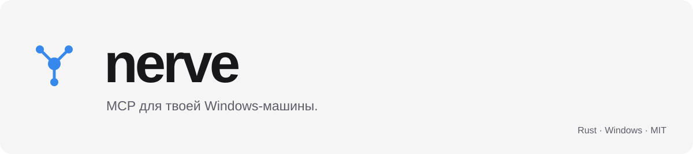
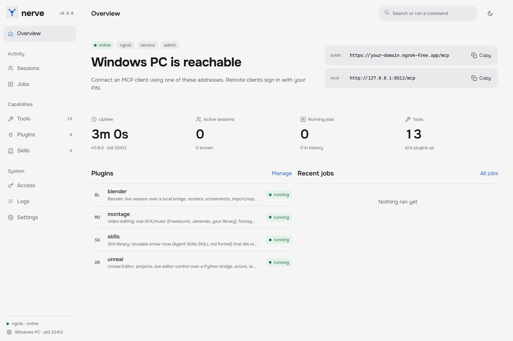

<picture>
  <source media="(prefers-color-scheme: dark)" srcset="docs/header-dark.svg">
  
</picture>

[Скачать](https://github.com/EFSEEaXZ/nerve/releases/latest) · [Установить](#быстрый-старт) · [Подключить клиента](#подключение) · [Плагины](plugins/README.md)

Windows x86-64 · Rust · [MIT](LICENSE) · [Проверки](https://github.com/EFSEEaXZ/nerve/actions)

**Терминал, файлы, браузер и рабочий стол — через один MCP-сервер.**

nerve соединяет AI-клиент с твоим Windows-ПК. Ядро — один бинарник на Rust: HTTP/SSE, OAuth со входом по PIN, фоновые задачи, локальная панель и трей. Плагины добавляют Blender, Unreal, монтаж видео и библиотеку скиллов.

<picture>
  <source media="(prefers-color-scheme: dark)" srcset="docs/dashboard-dark.png">
  
</picture>

*Панель в демонстрационном окружении. Адреса и данные на снимке — примеры, не чужие ключи.*

##  Быстрый старт

**Windows x86-64.** Скачай `nerve-windows-x86_64.zip` из [Releases](https://github.com/EFSEEaXZ/nerve/releases/latest), распакуй в отдельную папку и открой там PowerShell.

```powershell
# Задай свой PIN: ввод интерактивный, в команду его добавлять не нужно.
.\nerve.exe pin set

# Запуск в текущем терминале.
.\nerve.exe serve
```

Панель: **http://127.0.0.1:8100/ui**. Конфиг создаётся при первом запуске в `%LOCALAPPDATA%\nerve\config.toml`; [config.example.toml](config.example.toml) — справочный пример, без готовых ключей.

Хочешь запуск вместе с Windows? Из **PowerShell администратора**:

```powershell
.\nerve.exe service install
```

Ядру не нужны Node.js или Python. Для Python-плагинов нужен Python, для браузера — Chrome/Edge, для внешнего туннеля — соответствующий CLI и **твой** аккаунт.

### Собрать самостоятельно

Актуальный stable Rust и Windows build tools:

```powershell
git clone https://github.com/EFSEEaXZ/nerve.git
cd nerve
cargo build --release --locked
.\target\release\nerve.exe pin set
.\target\release\nerve.exe serve
```

## Подключение

| Где работает клиент | Адрес | Вход |
| :-- | :-- | :-- |
| На этом же ПК | `http://127.0.0.1:8100/mcp` | По умолчанию без OAuth; доступ только через loopback |
| Notion, Claude, другой удалённый клиент | `https://<твой-туннель>/mcp` | OAuth + твой PIN |
| Скрипт / CI | Твой MCP endpoint | Собственный API-токен |

API-токен создаётся командой `nerve token create <name>` и передаётся как `Authorization: Bearer <token>`. Не отправляй его в GitHub или публичный чат.

### Свой ngrok

1. Установи ngrok CLI и подключи **свой** аккаунт по инструкции ngrok.
2. В локальном `config.toml` выбери провайдер и, если есть, свой домен:

```toml
[tunnel]
provider = "ngrok"
ngrok_domain = "your-domain.ngrok-free.app"
# Если токен уже сохранён в ngrok CLI, оставь это поле пустым.
ngrok_authtoken = ""
```

3. Перезапусти nerve и скопируй **Public MCP URL** из панели.

Никакой общий ngrok-аккаунт не поставляется. Также доступны `cloudflared`, `zrok`, `tailscale` и собственная команда туннеля; настройки описаны в [примерe конфига](config.example.toml). Панель `/ui` остаётся только на локальном listener, не на публичном endpoint.

##  Что внутри

| Инструмент | Для чего |
| :-- | :-- |
| `exec` | PowerShell / cmd / bash, прямой запуск программ, inline Python / Node, тайм-ауты и прогресс |
| `job` | Фоновые процессы, живые логи, ожидание, остановка дерева процессов; задачи переживают перезапуск сервера |
| `fs` | Файлы, точечные правки, сохранение кодировки и CRLF, поиск и grep |
| `image` | Просмотр изображений с ограничением размера, регионы и тайлы |
| `browser` | Chrome/Edge через CDP, отдельный постоянный профиль |
| `ui` | Окна, скриншоты, OCR, UI Automation, мышь и клавиатура |
| `sys` | Процессы, состояние сервера, логи, перезапуск и обновление |
| `net` | HTTP, загрузки, TCP и DNS |
| `plugin` | Подключение, настройка и горячая перезагрузка дополнительных инструментов |

Короткие вызовы возвращаются через JSON; долгие — через SSE с keep-alive и прогрессом. Очень большие текстовые результаты сохраняются целиком на диске, а клиент получает компактное превью и путь к файлу: задача не должна застревать из-за огромного ответа.

### Панель и трей

- Две темы, локальный Onest, спокойные заливки и кастомный скроллбар.
- Поиск страниц и команд по `Ctrl K`.
- Настройки плагинов, редактор скиллов, доступы, задачи и логи.
- Трей с той же палитрой: панель, MCP URL, проверка обновлений, перезапуск и папки.
- В меню трея работают стрелки, Enter и Escape. Тема синхронизируется с последним выбором в панели.

##  Расширения без форка

В комплекте: **Blender**, **Unreal**, **Montage** и **Skills**. Это дополнительные Python-процессы, а не обязательные зависимости ядра. Blender/Unreal и внешние приложения устанавливаются отдельно.

Плагин — папка с `plugin.toml` и программой, говорящей по MCP через stdin/stdout. Изменения подхватываются автоматически; перезапускать сервер не нужно. Python SDK превращает функции с `@p.tool` в MCP-инструменты.

[Как написать плагин →](plugins/README.md)

Скиллы — папки с `SKILL.md`, инструкциями и дополнительными файлами. Встроенная библиотека содержит только `weapon-3d-blender` — моделирование и рендеры оружия в Blender. Их можно читать, редактировать и устанавливать через **Skills → Install from GitHub**. Обрабатывай сторонние скиллы и плагины как код из внешнего источника: сначала проверяй, что устанавливаешь.

##  Обновления

Источник закреплён: **[EFSEEaXZ/nerve · GitHub Releases](https://github.com/EFSEEaXZ/nerve/releases)**. Произвольного поля «вставь URL бинарника» в панели нет.

По умолчанию nerve проверяет стабильный релиз раз в 6 часов. Автоматическая установка ждёт, пока нет активных MCP-вызовов и минимум минуту не было MCP-активности. Перед заменой проверяются SHA-256 и соответствие версии бинарника тегу. Туннель и фоновые задачи сохраняются при перезапуске.

```toml
[updates]
automatic = true
check_interval_secs = 21600
```

Автоустановку можно отключить: `automatic = false`. Ручная проверка остаётся в **Settings → Updates**; команда `nerve update` ставит обновление из того же репозитория. Для локальной разработки и восстановления CLI/MCP дополнительно принимают **локальный файл**, но не произвольный сетевой URL.

GitHub-токен в приложение не вшит. Публичные релизы скачиваются без авторизации. Контрольная сумма защищает от повреждения файла, а не от компрометации аккаунта издателя — доверяй только тому источнику, которому готов дать исполнение на своём ПК.

##  До подключения AI-клиента

**nerve даёт клиенту серьёзные права:** запуск программ, чтение и изменение файлов, управление рабочим столом и доступ к браузерной сессии.

- Подключай только клиентов и людей, которым доверяешь.
- Используй собственный PIN и собственный туннель. Без установленного PIN удалённый OAuth-вход отключён.
- Не публикуй `auth.json`, `control.key`, рабочий `config.toml`, `.env`, браузерный профиль или журналы.
- Не запускай с правами администратора без необходимости.
- Релизный бинарник не подписан сертификатом Windows. При сомнениях собирай из проверенных исходников.

[Модель безопасности и сообщение об уязвимости →](SECURITY.md)

---

[MIT](LICENSE) · [Releases](https://github.com/EFSEEaXZ/nerve/releases) · [Issues](https://github.com/EFSEEaXZ/nerve/issues)
